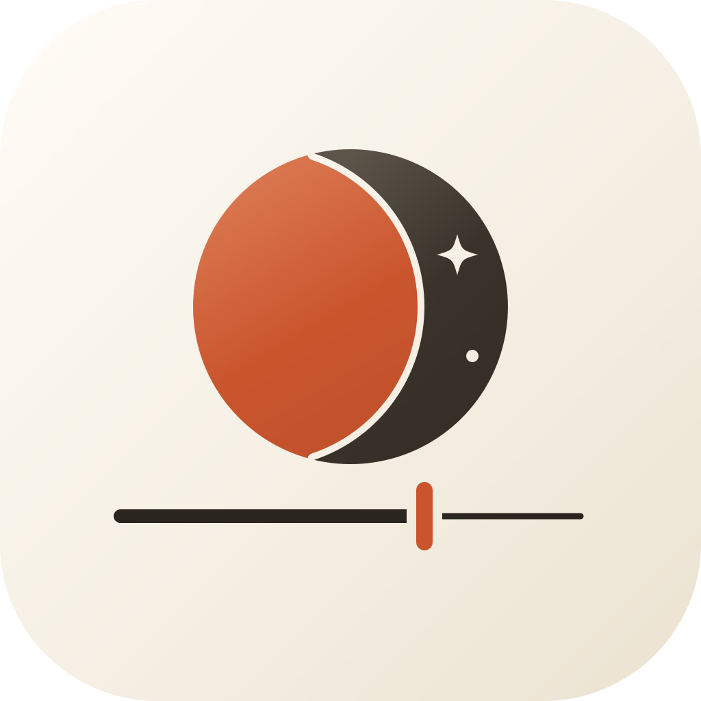
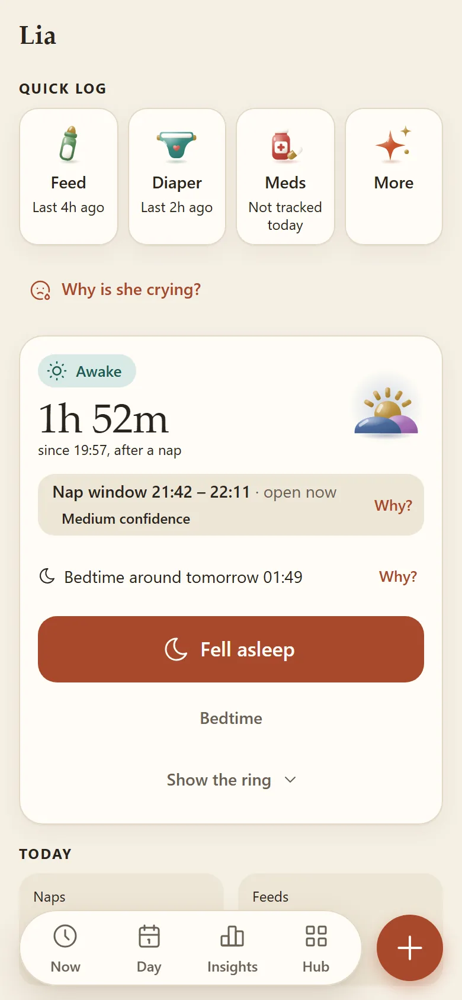
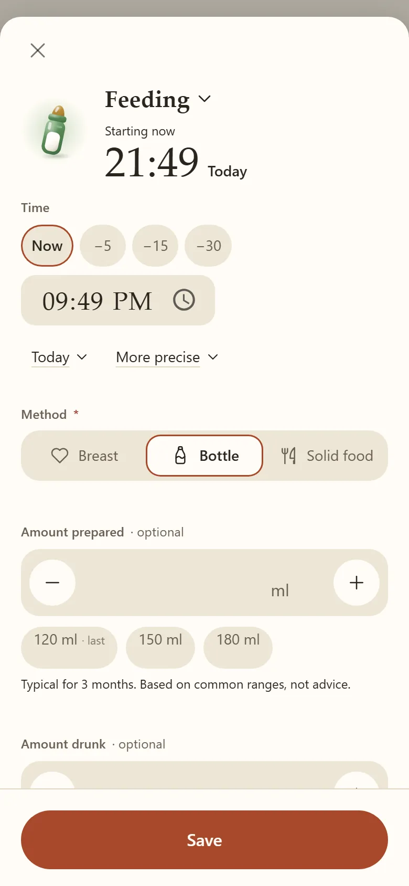
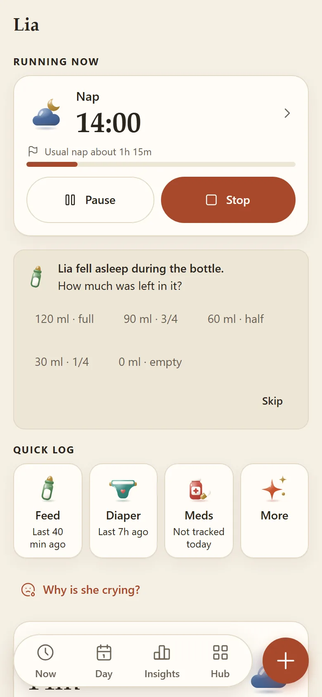
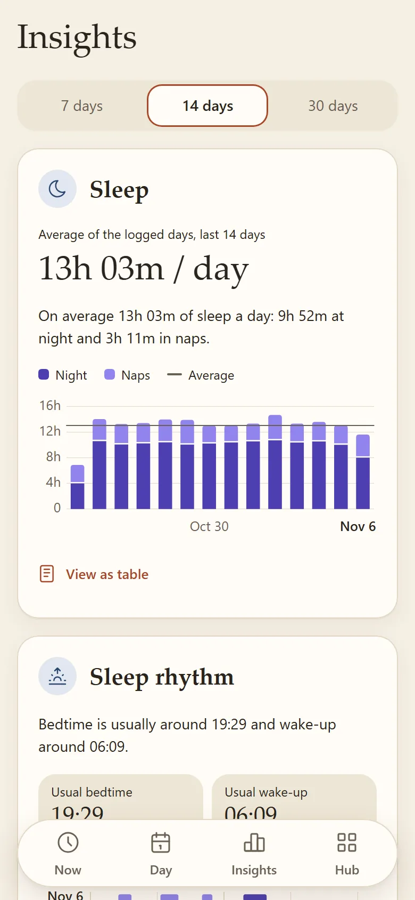
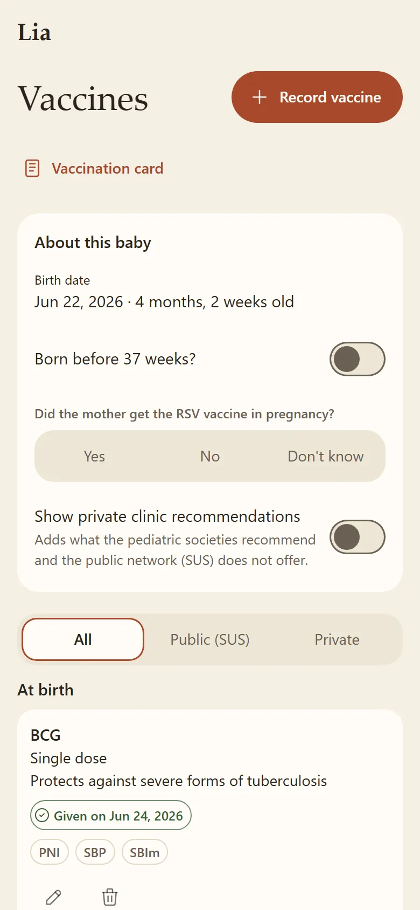
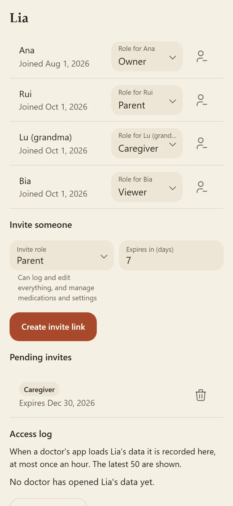
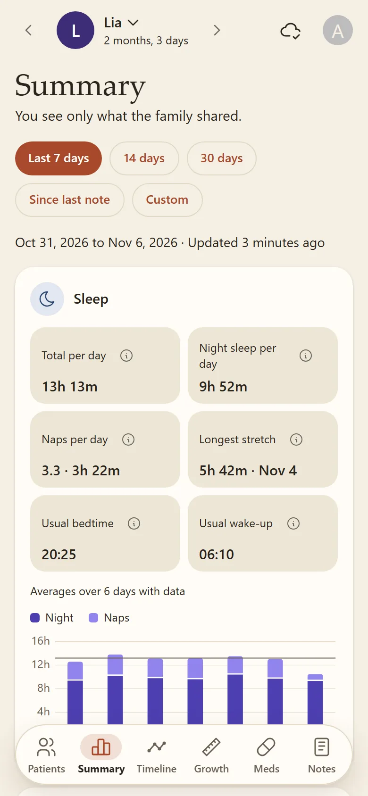
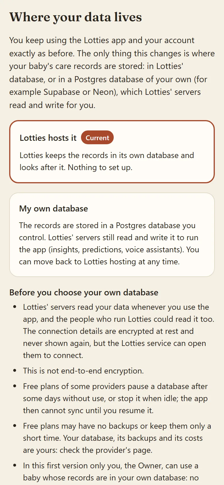

<p align="center">
  
</p>

<p align="center"><strong>Lotties</strong><br>Track your baby's day, together</p>

# Lotties

Open-source baby event-tracking PWA. Log feeds, sleep, diapers and other routines, share them with your family, and see simple predictions for the next ones. Works offline and syncs when you reconnect.

## See it in action

<p align="center">
  <a href="code/web/public/showcase/demo-en.mp4" title="Open the full quality video (MP4)">
    
  </a>
  <br><sub>50 s tour, no sound. Full quality: <a href="code/web/public/showcase/demo-en.mp4">MP4</a>, <a href="code/web/public/showcase/demo-pt-BR.mp4">em português</a></sub>
</p>

<table>
<tr>
  <td align="center"><br><sub>Now screen</sub></td>
  <td align="center"><br><sub>Log a feed</sub></td>
  <td align="center"><br><sub>Bottle follow-up</sub></td>
  <td align="center"><br><sub>Insights</sub></td>
  <td align="center"><br><sub>Vaccines</sub></td>
  <td align="center"><br><sub>Sharing with a caregiver</sub></td>
  <td align="center"><br><sub>Doctor view</sub></td>
  <td align="center"><br><sub>Where your data lives</sub></td>
</tr>
</table>

All pictures show a made-up baby with made-up events, never a real family. Also in Brazilian Portuguese and dark mode: [`code/web/public/showcase/`](code/web/public/showcase/). They are regenerated from the app itself, see [docs/showcase-media.md](docs/showcase-media.md).

## Stack

- **code/web/**: React 19, TypeScript, MUI, Vite, PWA (vite-plugin-pwa)
- **code/api/**: .NET 10 Web API (Domain / Application / Infrastructure / Api), EF Core + Npgsql
- **Database**: PostgreSQL 16
- **Auth**: generic OIDC (Auth0 default; Keycloak/Authentik via config)
- **Deploy**: docker compose (api + web behind nginx, optional local Postgres)

## Quick start

Prerequisites: .NET 10 SDK, Node 22, and optionally Docker.

```bash
# API
dotnet build code/api/Lotties.sln
dotnet test code/api/Lotties.sln

# Web
npm --prefix code/web ci
npm --prefix code/web run dev
npm --prefix code/web run test -- --run
npm --prefix code/web run lint
npm --prefix code/web run build
```

Want to run your own copy? See [Run it yourself](#run-it-yourself) below.

With Docker: copy `.env.example` to `.env`, fill in the values, then run `docker compose up --build`. Add `--profile localdb` to start a local PostgreSQL container too. Full deployment guide (identity provider setup, TLS, database roles): [docs/DEPLOY.md](docs/DEPLOY.md).

## Environment variables

| Variable | Purpose |
|----------|---------|
| `DB_HOST` | Database host (`postgres` with the `localdb` profile) |
| `DB_PORT` | Database port (default 5432) |
| `DB_NAME` | Database name (compose default `lotties`) |
| `DB_APP_USER` | Application database user |
| `DB_APP_PASSWORD` | Application database password |
| `DB_AUTO_MIGRATE` | `true` applies pending EF Core migrations at API startup (config `Database:AutoMigrate`); default `false`, for development/self-hosting; production applies them with `dotnet ef` (see [docs/DEPLOY.md](docs/DEPLOY.md) "Applying migrations") |
| `DB_MIGRATOR_USER`, `DB_MIGRATOR_PASSWORD` | Role with DDL rights used to apply migrations (`dotnet ef`, or the API with `DB_AUTO_MIGRATE`); falls back to `DB_APP_*` |
| `POSTGRES_PASSWORD` | Password of the optional `localdb` container (user is `DB_APP_USER`); no default |
| `VITE_OIDC_AUTHORITY`, `VITE_OIDC_CLIENT_ID`, `VITE_OIDC_AUDIENCE`, `VITE_API_BASE_URL` | Web build arguments (public, compiled into the bundle); see [docs/DEPLOY.md](docs/DEPLOY.md) |
| `VITE_REPO_URL` | Optional web build argument: source repository link in the landing page footer (http/https only); empty (default) hides it |
| `VITE_ISSUES_URL` | Optional web build argument: "Report a problem" link (http/https only); empty = `VITE_REPO_URL` + `/issues/new`, else a `mailto:` to `VITE_PRIVACY_CONTACT_EMAIL`, else hidden ([docs/DEPLOY.md](docs/DEPLOY.md) "Footer links") |
| `VITE_SUPPORT_URL` | Optional web build argument: "Support Lotties" link (http/https only, a link out, no payment in the app); empty (default) hides it |
| `VITE_PRIVACY_CONTROLLER_NAME`, `VITE_PRIVACY_CONTACT_EMAIL`, `VITE_PRIVACY_DPO` | Web build arguments (public): who is responsible for the data, the privacy contact and the encarregado shown on `/privacy`; empty = neutral defaults. Set them before a store submission ([docs/PRIVACY-OWNER-CHECKLIST.md](docs/PRIVACY-OWNER-CHECKLIST.md)) |
| `AUTH_AUTHORITY` | OIDC issuer URL (config `Auth:Authority`); required outside Development |
| `AUTH_AUDIENCE` | API audience that access tokens must carry (config `Auth:Audience`); required outside Development |
| `AUTH_ADMIN_CLIENT_ID`, `AUTH_ADMIN_CLIENT_SECRET` | Optional Keycloak service account (config `Auth:AdminClientId`/`AdminClientSecret`) so account deletion also removes the sign-in account; see docs/DEPLOY.md |
| `CORS_ALLOWED_ORIGINS` | Comma-separated browser origins allowed to call the API, e.g. the web app URL (config `Cors:AllowedOrigins`); not needed when the web container proxies `/api/` (default) |
| `PUSH_VAPID_PUBLIC_KEY`, `PUSH_VAPID_PRIVATE_KEY`, `PUSH_VAPID_SUBJECT` | Optional Web Push (config `Push:Vapid:*`); all three set = push on, none = off; generate with `--generate-vapid-keys`; see [docs/DEPLOY.md](docs/DEPLOY.md) "Push notifications" |

Never commit `.env`. See `.env.example` for placeholders.

## Run it yourself

Lotties is AGPL-3.0 software: anyone can run their own copy. `lotties.app` is only the instance the maintainers run, and the
maintainers are responsible only for the data on that instance and for the privacy terms published there. If you run your own
copy you are the operator: you hold the data and the backups, you choose who signs in, and you publish the privacy terms that
fit your copy (set the controller and contact with the `VITE_PRIVACY_*` values). Nothing you store reaches the maintainers.

The public page `/self-host` (<https://lotties.app/self-host>, or the same path on any copy) explains what you need and has a
generator that writes your `.env` and `docker-compose.yml` in the browser; nothing you type or generate leaves the page. The
full guide is [docs/DEPLOY.md](docs/DEPLOY.md).

## Install on your phone

Lotties is a web app you add from the browser, no app store needed. The links and steps below use the maintainers' instance,
`lotties.app`; if you use a copy run by someone else, use that copy's address instead. Full guide with pictures:
<https://lotties.app/install> (the same page exists at `/install` on every copy).

- **iPhone or iPad** (iOS/iPadOS 16.4 or later): open lotties.app (or your copy's address) in Safari, tap Share (bottom toolbar, or under ••• on newer iOS; top right on iPad), scroll to **Add to Home Screen**, tap **Add**, then open Lotties from the Home Screen. On iPhone and iPad notifications only work in the Home Screen app. Chrome, Edge and Firefox on recent iOS can do the same from their Share menu; Safari is the most reliable.
- **Android**: in Chrome tap **Install app** on the page, or the menu (three dots) > **Install app** (or **Add to Home screen**) > **Install**. Samsung Internet: menu > **Add page to** > **Home screen**. Then allow notifications when Lotties asks.
- **Computer**: Chrome or Edge, the install icon at the right of the address bar; Safari on a Mac, **File > Add to Dock**.

Inside Instagram, Facebook or another app's browser the option is missing: open the page in Safari or Chrome first.

## Privacy

What the maintainers' instance (lotties.app) collects, why, who receives it and how to download or delete your data:
<https://lotties.app/privacy> (no sign-in needed; also Hub > App > Privacy policy). A copy run by someone else has its own
operator and its own privacy terms. The audit behind it is
[docs/design/33-privacy-audit.md](docs/design/33-privacy-audit.md).

### Your data, your choice (optional, off by default for now)

Lotties hosting stays the default, and nothing changes for anyone who does not choose otherwise. As an **option**, a
baby's Owner can keep that baby's care records in a Postgres database of her own (Supabase, Neon or any public Postgres)
instead of Lotties' database, from Settings > Where your data lives, per baby, and move them back at any time. The app and
the account stay exactly the same, and everything still goes through the Lotties API: Lotties' servers read and write the
records to run the app, and the connection details are stored sealed but can be opened by the service (and so by its
operator) to connect. It is control over where the data lives, not end-to-end encryption. In this first version it is for a
baby with no other members, without reminders or doctor access, and it is off on the server unless the operator turns it
on for listed accounts; the provider steps have not yet been tested on a real Supabase or Neon account.

- User guide: [docs/BYO-DATABASE.md](docs/BYO-DATABASE.md) (also in the app at `/help/own-database`).
- Setup SQL for `psql`: [docs/sql/byo-setup.sql](docs/sql/byo-setup.sql) (the app generates the same SQL for you).
- Operators: [docs/DEPLOY.md](docs/DEPLOY.md) ("Bring your own database: turning it on" and the sections after it).
- Design: [docs/design/47-bring-your-own-database.md](docs/design/47-bring-your-own-database.md).

The screen is in the showcase as `data-location`, in light and dark mode ([`code/web/public/showcase/`](code/web/public/showcase/)).

## Credits and open-source acknowledgements

Lotties is free software and stands on the work of many people: the open-source libraries it ships, the public data it uses
(Anvisa, the Ministry of Health vaccine calendar, OpenStreetMap) and the services it calls (BrasilAPI, ViaCEP, Nominatim),
plus Keycloak and PostgreSQL. Thank you to every author and maintainer.

- [CREDITS.md](CREDITS.md): the thanks page, with data sources, services and direct dependencies.
- [THIRD_PARTY_NOTICES.md](THIRD_PARTY_NOTICES.md): the license texts of every bundled package.
- In the app: <https://lotties.app/credits> (no sign-in needed), and Hub > App > Credits and licenses.

Both files are generated from the dependency files (`node code/web/scripts/generate-credits.mjs`, see
[docs/design/25-credits.md](docs/design/25-credits.md)). Naming a project here credits it; it does not mean it endorses Lotties.

## License

AGPL-3.0. See [LICENSE](LICENSE).
